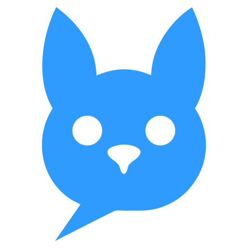

# bostie


A Discord library for Python with a Rust core, built around voice that keeps working.

> **Status:** pre-alpha. Text bots work: slash commands, buttons and selects, gateway events, the cache and REST. Voice comes next.

## Goals

- **Voice first.** Discord requires end-to-end encrypted voice (DAVE) since March 2026, and most Python libraries still struggle with it, especially when receiving audio. bostie will run the whole voice path in Rust, outside the GIL, so audio timing never depends on what your Python code is doing.
- **Survives Discord changes.** Models will be tolerant: unknown fields, enum values and components never break decoding, every object keeps its raw payload, and raw escape hatches reach new events and endpoints before bostie models them.
- **Fast.** The gateway, compression, HTTP and rate limiting run in Rust; Python decodes raw JSON into compact `msgspec` models. Every performance claim comes with a benchmark against other libraries.

## Example

```python
from enum import Enum
from typing import Annotated, Literal

import bostie
from bostie import ComponentContext, Context, Range, ui
from bostie.events import MessageCreate

bot = bostie.Bot(dev_guilds=[123456789012345678])


class Unit(Enum):
    METRIC = "metric"
    IMPERIAL = "imperial"


@bot.command
async def roll(
    ctx: Context,
    sides: Annotated[Range[int, 2, 100], "Sides per die"] = 6,
    mode: Literal["sum", "list"] = "sum",
    unit: Unit = Unit.METRIC,
) -> None:
    """Roll some dice."""
    again = ui.button("Again", custom_id=reroll.id(sides=sides))
    await ctx.respond(
        components=[ui.text(f"d{sides} in {mode} mode ({unit.value})"), ui.row(again)]
    )


@bot.on_component("reroll:{sides:int}")
async def reroll(ctx: ComponentContext, sides: int) -> None:
    await ctx.update(components=[ui.text(f"Rolled a d{sides} again")])


@bot.listen
async def wave_back(event: MessageCreate) -> None:
    message = event.message
    mentioned = {user.id for user in message.mentions}
    if bot.user and bot.user.id in mentioned and message.channel_id:
        await bot.send_message(
            message.channel_id,
            components=[ui.text("Hi! Try /roll.")],
            reply_to=message.id,
        )


bot.run()
```

`bot.run()` reads the token from `BOSTIE_TOKEN`. Commands sync on startup only when they changed, and a handler that has not answered after 2.5 s is deferred for you. Messages use Components V2: `ui.text`, `ui.section`, `ui.container`, `ui.media_gallery`, `ui.file` and `ui.separator` build them, and bostie sets the `IS_COMPONENTS_V2` flag for you. The listener needs no privileged intent: mentions always arrive, and a message that mentions the bot carries its content too. Options come from the type hints; choices come from a `Literal` of strings or ints, an `Enum`, or `Option(choices=...)`. Button custom ids are typed templates, so they survive restarts.

Everything bostie does not model yet stays reachable: `bot.http.request("GET", "/guilds/{guild_id}/soundboard-sounds", guild_id=...)` calls any endpoint, `bot.gateway.send(op=..., d=...)` sends any opcode, and `@bot.listen_raw("EVENT_NAME")` receives any dispatch. Split a bot across modules with `bostie.Router()` and `bot.include(router)`.

## Layout

| Path | What lives there |
|---|---|
| `crates/bostie-core` | Rust core: async runtime, networking, protocol. No Python dependency. |
| `crates/bostie-native` | Thin PyO3 bindings exposing the core as `bostie._native`. |
| `python/bostie` | The public Python API. |

## License

Licensed under either of [Apache License 2.0](LICENSE-APACHE) or [MIT](LICENSE-MIT), at your option.

bostie is not affiliated with Discord Inc.
