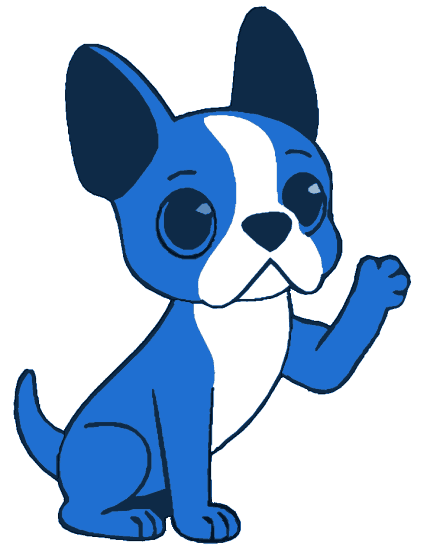

# bostie



A Discord library for Python with a Rust core, built around reliable voice.

> **Status:** pre-alpha, and the API can still change. Slash, user and message commands, components, modals, gateway events, the cache, REST, webhooks, HTTP interactions, OAuth2, and voice playback and receiving work today.

```python
import bostie
from bostie import ComponentContext, Context, ui, voice

bot = bostie.Bot()


@bot.command
async def play(ctx: Context, url: str) -> None:
    """Play a direct media URL in your voice channel."""
    vc = ctx.voice.current or await ctx.voice.connect()
    await vc.play(voice.Url(url))
    stop = ui.button("Stop", custom_id=stop_playing.id(guild_id=vc.guild_id))
    await ctx.respond(components=[ui.text(f"Playing <{url}>"), ui.row(stop)])


@bot.on_component("stop:{guild_id:int}")
async def stop_playing(ctx: ComponentContext, guild_id: int) -> None:
    if (vc := bot.voice.get(guild_id)) is not None:
        vc.stop()
    await ctx.update(components=[ui.text("Stopped.")])


bot.run()
```

`/play` joins the caller's voice channel, streams the URL and answers with a Stop button whose custom id carries the guild id, so it keeps working after a restart. `bot.run()` reads the token from `BOSTIE_TOKEN` and registers the command when it changed.

## What sets it apart

- The voice engine runs on Rust threads, outside the GIL: the 20 ms clock, decoding, mixing, Opus, encryption and [DAVE](https://docs.discord.com/developers/topics/voice-connections), the end-to-end encryption Discord has required since March 2026. It plays files, URLs and HLS streams, receives each speaker on their own, and records calls.
- Unknown fields, enum values, components and interaction types never break decoding, and every payload stays reachable raw, so a bot keeps working when Discord adds something.
- Models are typed as Discord documents them: a field Discord always sends is never `None`, and a partial object such as a member resolved from an option has its own class.
- Command options, choices, ranges and autocomplete come from type hints, and Discord's limits are checked when the decorator runs.
- `bostie.testing` is a fake Discord on localhost that tests run the real bot against.

## Install

You need Python 3.12 or newer, Rust 1.95 or newer ([rustup.rs](https://rustup.rs)) and [CMake](https://cmake.org/download/). Clone the repository and install the clone into your bot's environment:

```sh
pip install path/to/bostie
```

The first install compiles the Rust core and libopus, which takes a few minutes. `python -m bostie` prints the installed version.

## Documentation

- [Quickstart](docs/quickstart.md): create the application and run a first bot.
- Guides: [slash commands](docs/guide/commands.md), [answering interactions](docs/guide/responses.md), [components](docs/guide/components.md), [events](docs/guide/events.md), [REST](docs/guide/rest.md), [testing](docs/guide/testing.md) and more.
- [Voice](docs/voice/index.md): connections and DAVE, playback, raw audio, receiving and recording.
- [Reference](docs/reference/bot-options.md): every `Bot` option, every event, and the API.
- [Examples](examples/): complete bots, each type-checked in CI.

## Contributing

[CONTRIBUTING.md](CONTRIBUTING.md) explains the setup and the checks a pull request must pass. Report security problems as [SECURITY.md](SECURITY.md) describes.

## License

Licensed under either of [Apache License 2.0](LICENSE-APACHE) or [MIT](LICENSE-MIT), at your option.

bostie is not affiliated with Discord Inc.
