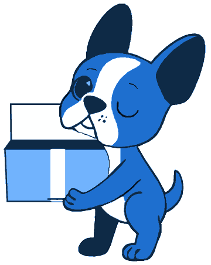

# Cache and permissions

{ align=right width="180" loading=lazy }

`bot.cache` keeps what the gateway told the bot, so handlers can look things up without a request. It is filled from events, never from REST calls you make.

```python
--8<-- "docs/snippets/cache/cache_lookups.py"
```

## What it keeps

| Kept | By default | Option |
|---|---|---|
| guilds, with their roles, emojis and stickers | yes | |
| channels and active threads | yes | |
| voice states | yes | |
| scheduled events, stage instances and soundboard sounds | yes | |
| the bot's user and its own member in each guild | yes | |
| all members | no | `members=True`, needs `Intents.GUILD_MEMBERS` |
| presences of members who are not offline | no | `presences=True`, needs `Intents.GUILD_PRESENCES` |
| the latest messages | no | `max_messages=N` |
| the latest DM channels | no | `max_dm_channels=N` |

`Bot(cache=False)` keeps nothing, and the other options then raise `ValueError`. An option whose intent is missing raises `MissingIntent` when the `Bot` is created. Channels are stored as Discord sent them, except the fields `CHANNEL_UPDATE` does not keep current (`last_message_id`, `message_count`, `member_count`, `last_pin_timestamp`), which are `None`.

With `members=True`, Discord sends only some members of large guilds when the bot connects. bostie then asks for the rest, one guild at a time per shard, and a shard counts as ready only once its guilds are complete. `chunk_members=False` skips that, and the cache fills as members join, change or speak. Rate-limited requests are retried after Discord's delay.

## Lookups

| Method | Returns |
|---|---|
| `guild(id)`, `guilds()` | one `Guild` or all of them |
| `channel(id)`, `guild_channels(guild_id)` | a `Channel`, or a guild's channels with its active threads |
| `role(id)`, `guild_roles(guild_id)` | a `Role`, or a guild's roles |
| `voice_state(guild_id, user_id)`, `guild_voice_states(guild_id)` | where users are in voice; `None` when the user is in no voice channel |
| `scheduled_event(id)`, `guild_scheduled_events(guild_id)` | a `ScheduledEvent`, or a guild's |
| `stage_instance(id)`, `guild_stage_instances(guild_id)` | a live `StageInstance`, or a guild's |
| `soundboard_sound(sound_id)`, `guild_soundboard_sounds(guild_id)` | a `SoundboardSound`, or a guild's |
| `me(guild_id)` | the bot's own `Member` in a guild |
| `member(guild_id, user_id)`, `guild_members(guild_id)` | members; only the bot's own unless `members=True` |
| `presence(guild_id, user_id)`, `guild_presences(guild_id)` | presences, with `presences=True`; `None` when offline |
| `user(id)` | the bot's user, or the user of a cached member or DM channel |
| `dm_channel(user_id)` | the bot's DM channel with a user, if kept |
| `message(id)` | one of the latest `max_messages` messages |
| `permissions(channel_id, member=None)` | a member's permissions in a channel, the bot's when `member` is left out |
| `guild_permissions(guild_id, member=None)` | the same, guild-wide |

Lookups return `None`, or an empty list, for what the cache does not hold. `bot.cache.clear()` empties it. Update and delete events carry the cached object from before the change, as [Events](events.md#old-values-and-the-cache) explains.

## The cache, else REST

```python
--8<-- "docs/snippets/cache/lookups_with_rest.py"
```

`bot.lookup` returns an object from the cache when it holds it, and asks REST for it otherwise: `user(user_id)`, `member(guild_id, user_id)`, `channel(channel_id)`, `guild(guild_id)`, `role(guild_id, role_id)` and `message(channel_id, message_id)`. What REST returns is not stored: the cache keeps following the gateway only, so a second lookup of the same missing object asks again. The REST errors pass through, such as `NotFound` for an id that does not exist.

## Scheduled events, stages and sounds

```python
--8<-- "docs/snippets/cache/guild_events.py"
```

They arrive with each guild and follow their create, update and delete events, which need `Intents.GUILD_SCHEDULED_EVENTS` for scheduled events and `Intents.GUILD_EXPRESSIONS` for soundboard sounds; both are in `Intents.DEFAULT`. The answer to `bot.request_soundboard_sounds` replaces a guild's sounds. Their update events carry `old`, and `SoundboardSoundDelete` the removed `sound`.

## Startup

A shard is ready once every guild its `READY` listed has arrived as a `GuildCreate`, or once no guild has arrived for `guild_ready_timeout` seconds, 2 by default. `Started` waits for every shard. A `GuildCreate` with `joined=True` is a guild the bot was just added to; the others are guilds becoming available.

`large_threshold`, 50 to 250 and 50 by default, is the member count above which Discord sends a guild without its offline members.

## Permissions

`cache.permissions(channel_id, member)` applies Discord's rules: the guild owner and administrators have everything; otherwise the `@everyone` role, then the member's roles, then the channel's overwrites for `@everyone`, the roles and the member; a timed-out member keeps only View Channel and Read Message History; without View Channel there is nothing; without Send Messages the permissions that need it go; in a voice channel without Connect, the voice permissions go. A thread uses its parent channel's overwrites. It returns `None` when the cache lacks the channel, the guild or a thread's parent.

The same computation is available without the cache: `bostie.permissions.compute_permissions(guild, member, channel=None, *, parent=None)`, where `parent` is a thread's parent channel. That module also holds `Permissions` sets taken from Discord's documentation: `ALL`, `NONE`, `TEXT`, `VOICE` and `STAGE` (the permissions that apply to each kind of channel), `ELEVATED` (those that need two-factor authentication on the moderator's account when the guild requires it) and `TIMED_OUT` (those a timed-out member keeps).

Inside an interaction there is no need for the cache: `ctx.interaction.app_permissions` holds the bot's permissions in the channel, and `ctx.member.permissions` the user's.

## Role hierarchy

A member can kick, ban, time out or edit only members whose highest role is lower than its own, and Discord shows a member's name in the color of its highest colored role. `bostie.permissions` has the three helpers, which take the `Guild` and members from the cache, an interaction or REST:

| Helper | Returns |
|---|---|
| `top_role(guild, member)` | the member's highest `Role`, or `None` when it has only `@everyone` |
| `display_colors(guild, member)` | the `RoleColors` of its highest role with a color, or `None` |
| `can_act_on(guild, actor, target)` | whether `actor` outranks `target`, a member or a role: the owner outranks everyone, nobody outranks the owner, and otherwise the actor's highest role compares by position with the target's highest role, or with the role itself, as Discord does for role management |

Roles at the same position rank by id, the older role first, as Discord orders them.

```python
--8<-- "docs/snippets/cache/role_hierarchy.py"
```
