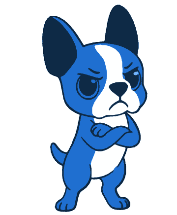

# Checks, hooks and errors

{ align=right width="180" loading=lazy }

A check decides whether a handler may run. Hooks run code before and after handlers. Error hooks answer when something raises.

## Checks

```python
--8<-- "docs/snippets/checks/command_checks.py"
```

A check is a function that takes the context and returns a `bool`, or awaits one. `False` refuses the run with `CheckFailure`, and a check can raise a `CheckFailure` of its own: its message is what the user is told. Checks go in the `checks=[...]` setting of a command, group, subcommand, user or message command, entry point, or component and modal route, and `@router.check` registers one for every handler of a router; the bot is a router.

The checks of the bot run first, then those of each router from the outermost in, then those of the groups from the top down, then the command's own. The first refusal stops the run. Autocomplete runs no checks.

`bostie.checks` has the common ones:

| Check | Refuses with | When |
|---|---|---|
| `has_permissions(permissions)` | `MissingPermissions` | the user lacks any of `permissions` in the channel, or is in a DM |
| `bot_has_permissions(permissions)` | `BotMissingPermissions` | the bot lacks any of them in the channel |
| `Cooldown(rate, seconds, per="user")` | `CooldownActive` | the key already used it `rate` times in the last `seconds` |
| `MaxConcurrency(number, per="global")` | `MaxConcurrencyReached` | `number` runs for the key are still going on |
| `has_role(role)` | `MissingRole` | the user lacks the role, given by id or name, or is in a DM |
| `has_any_role(*roles)` | `MissingRole` | the user has none of the roles |
| `is_owner` | `NotOwner` | the user is not one of `bot.owner_ids` |

A check object that also has a `release(ctx)` method, a `checks.ReleasingCheck` like `MaxConcurrency`, is released once the handler ends, however it ends.

`per` is `"user"`, `"guild"` (the user, in DMs), `"channel"`, `"global"`, or a function of the context that returns any hashable key. The permission checks read the permissions Discord sends with the interaction, so they need no cache and no request. Their errors carry `missing`, the `Permissions` lacking, and `CooldownActive` carries `retry_after` in seconds.

## Roles and owners

```python
--8<-- "docs/snippets/checks/staff_checks.py"
```

`has_role` and `has_any_role` take role ids or names. An id is matched against the roles Discord sends with the interaction, so it needs no cache. A name is looked up among the roles of the cached guild, so a bot without the cache, or an [HTTP-only app](http-interactions.md), names roles by id. `MissingRole` carries the `roles` asked for, and its message mentions a role given by id, which Discord shows as the role's name.

`is_owner` is a check as it is, without parentheses. `bot.owner_ids` holds the users it lets through: the `owner_ids` given to `Bot(...)`, else the app's owner, read from the application when the bot starts. For an app that belongs to a team, they are the team's owner and the admins and developers who accepted the invitation; read-only members are left out.

## What the user is told

When no error hook handles a `CheckFailure`, bostie answers with its message, ephemeral: "You need the Manage Messages permission.", "The bot needs the Manage Messages permission.", "Try again" with a relative timestamp such as "in 42 seconds", "This is already running; try again once it is done.", "You need the Moderator role.", "Only the bot's owners can use this.", or "You cannot use this." for a plain `False`.

## Hooks before and after

```python
--8<-- "docs/snippets/checks/error_hooks.py"
```

`@router.before_invoke` registers `async def hook(ctx)` that runs after the checks passed and before the handler; `@router.after_invoke` one that runs after the handler, also when it raised. They run for every command, component route and modal route of the router, so a hook that may see a component should not assume a `Context`. The bot's before hooks run first and its after hooks last. An exception from an after hook is logged and does not change the answer.

## Error hooks

An exception from a check, a converter, a before hook or the handler goes to an error hook. `@x.on_error` registers `async def hook(ctx, error)` for every `Exception`, and `@x.on_error(NotFound, ValueError)` for those types and their subclasses. `x` is a command, a group, a component or modal route, a router or the bot, and each can have one hook per exception type.

bostie looks for a hook in this order, and the first it finds handles the error:

1. the command, then its group and the top-level group;
2. the router the command belongs to, then each router it is included in, up to the bot.

Within one place, the hook for the nearest class of the error wins: a hook for `NotFound` beats one for `HTTPException`. A hook that raises the same error passes it on to the next hook in that order, as `slow_down` does above. A hook that raises another error has it logged.

The context type is `ErrorContext`: a `Context`, `ComponentContext`, `ModalContext` or `AutocompleteContext`. The autocomplete context cannot `respond`, so check for it as above.

When a hook returns without answering, bostie logs a warning and answers "Something went wrong.". When no hook handles the error, bostie answers a `CheckFailure` with its message, and logs anything else with its traceback before it answers "Something went wrong.". Nothing is answered when the handler had answered already, and an autocomplete gets an empty list of suggestions.

## Errors outside handlers

Listeners and tasks have no user to answer. An exception in a listener is sent as a `ListenerError` event, and one in a task as a `TaskError`; without a listener for them, bostie logs them. See [Events](events.md#when-a-listener-raises) and [Background tasks](tasks.md).

## Exception types

Everything bostie raises about Discord, the network or the bot's state is a `BostieError`. A bad argument raises `ValueError` or `TypeError` instead. Some errors are also a standard exception: `StateError` is a `RuntimeError`, `MissingIntent` a `ValueError`, `StartupError` an `OSError` and `CommandDefinitionError` a `TypeError`. The errors about commands and interactions share the base `CommandError`, and the voice errors `VoiceError`.

| Exception | Raised when |
|---|---|
| `HTTPException` | a REST request ended with an error status; `status`, `code` (a `JSONErrorCode`), `message`, `errors` and the raw `body` |
| `BadRequest`, `Forbidden`, `NotFound`, `ServerError` | 400, 403, 404 and 5xx |
| `RateLimited` | 429, or bostie held back a request that would wait longer than `max_rate_limit_wait`; `retry_after`, `is_global` |
| `InvalidToken` | Discord rejected the token, on REST or the gateway |
| `TransportError` | a request failed before Discord answered |
| `UnexpectedResponse` | Discord accepted a request but its answer does not decode; `raw` holds it |
| `RequestBudgetExhausted` | too many recent requests were invalid, and bostie refused one to protect the IP |
| `GatewayClosed`, `PrivilegedIntentsRequired`, `ShardingRequired` | Discord closed the gateway for good; the last two for codes 4014 and 4011 |
| `ShardNotRunning`, `GatewayQueueFull` | a gateway command for a shard this process does not run, or with too many commands waiting |
| `StateError` | a call the object's state does not allow, such as `bot.rest` before `start()` |
| `MissingIntent` | a feature needs an intent the bot did not ask for |
| `MemberRequestRateLimited` | Discord refused a member request; `retry_after` |
| `StartupError` | bostie could not set up a system resource it needs |
| `CommandDefinitionError` | a command, group or option breaks Discord's rules; raised by the decorator |
| `CommandSyncError` | Discord rejected the commands during a sync |
| `OptionConversionError` | an option or target did not convert to its hint |
| `InteractionResponded`, `InteractionNotAnswered`, `InteractionExpired` | an answering call the interaction's state does not allow |
| `CheckFailure` and its subclasses | a check refused a run |

The voice errors are on the [voice page](../voice/index.md#errors). The [errors reference](../reference/api/errors.md) lists every class with its attributes.
