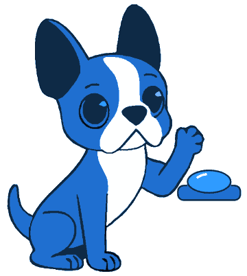

# Components

{ align=right width="180" loading=lazy }

Components are the buttons, select menus and layout blocks of a message. `bostie.ui` builds them as plain dictionaries in Discord's JSON shape, and checks Discord's limits as it builds them. A handler registered with `@bot.on_component` answers their uses.

`bostie.ui` is how you build components. The component models, such as `bostie.Button` or `bostie.ActionRow`, are what a decoded message's `components` hold; `components=` takes them too, so a message's components can be sent back, edited with `msgspec.structs.replace`, without rebuilding them, but they do not check Discord's limits.

## Layout

```python
--8<-- "docs/snippets/components/layout.py"
```

These are Components V2: the components make up the whole message, with `ui.text` in place of `content`, as [Message content](messages.md#components-v2) explains.

| Builder | What it shows |
|---|---|
| `ui.text(markdown)` | text, with Discord's markdown |
| `ui.section(*texts, accessory=...)` | one to three texts with a button or a thumbnail beside them |
| `ui.thumbnail(url, description=None, spoiler=False)` | a small image, only as a section's accessory |
| `ui.media_gallery(*items)` | one to ten images or videos, each a `ui.gallery_item(url, description=None, spoiler=False)` |
| `ui.file(filename, spoiler=False)` | a file uploaded with the message under that name |
| `ui.separator(divider=True, spacing=1)` | space between components, `spacing=2` for large, with a line unless `divider=False` |
| `ui.container(*components, accent_color=None, spoiler=False)` | a box around rows, texts, sections, galleries, files and separators, with a colored edge |
| `ui.row(*components)` | up to five buttons, or one select menu |

A URL can be `attachment://name` to show a file uploaded with the message. Every builder takes `id=` for the optional numeric component id, and `ui.raw(dict)` passes a component that `ui` has no builder for yet, unchanged. Too many items, a label that is too long or a select inside a row with buttons raises `ValueError` when you build it. Each builder returns a typed dictionary, such as `ui.ButtonDict`, `ui.RowDict`, `ui.TextDict`, `ui.SectionDict`, `ui.ThumbnailDict`, `ui.MediaGalleryDict`, `ui.GalleryItemDict`, `ui.FileDict`, `ui.SeparatorDict`, `ui.ContainerDict`, `ui.StringSelectDict`, `ui.SelectOptionDict`, `ui.EntitySelectDict` and `ui.SelectDefaultDict`, and `ui.raw` returns a `ui.RawComponent`; annotate your own helpers with them, as `ballot` below does.

## Buttons

- `ui.button(label, custom_id=..., style=ButtonStyle.SECONDARY)` sends `custom_id` to the bot when clicked. `style` is `PRIMARY`, `SECONDARY`, `SUCCESS` or `DANGER`.
- `ui.link_button(label, url)` opens a URL and never reaches the bot.
- `ui.premium_button(sku_id)` offers an SKU of the app for sale and never reaches the bot.

Buttons take `emoji=`: a Unicode emoji, a custom emoji written as Discord shows it (`<:name:id>`, or `<a:name:id>` when animated, as `fmt.emoji` makes it), or an `Emoji` or `PartialEmoji` model. `PartialEmoji.parse(text)` reads such a string. Buttons also take `disabled=True`. A label is at most 80 characters and a custom id 1 to 100.

## Routes

A route is a handler for every custom id that fits a template:

```python
--8<-- "docs/snippets/components/routes.py"
```

`"vote:{side:int}:{topic}"` matches `vote:0:Lunch at noon`. `{name}` captures one or more characters without a line break, and `{name:int}` an integer, negative ones included. The values reach the handler as keyword arguments, converted for `int`. Templates need literal text between two placeholders, and a template without placeholders matches its custom id exactly.

`vote.id(side=0, topic=topic)` builds the custom id from the route itself, so the template is written once. It raises `ValueError` if the id would be longer than Discord's 100 characters, or would not parse back to the same values.

The state lives in the custom id, not in a Python object, so a button sent last week still works after a restart, as long as its route is registered. `@bot.on_component` takes `ephemeral`, `auto_defer` and `checks`, like a command, and calling the route, as in `await vote(ctx, side=0, topic="x")`, calls the handler.

A component use that no route matches gets no answer: Discord shows "This interaction failed" and bostie logs a warning, unless you listen to `InteractionCreate`.

## Answering a component

A `ComponentContext` has the answering methods of a command's context, plus:

- `await ctx.update(**parts)` edits the message the component is on. Parts left out stay, and `None` clears one.
- `await ctx.defer_update()` acknowledges the use without a visible answer; `update` can edit the message within 15 minutes.
- `await ctx.modal(ui.modal(...))` opens a [modal](modals.md).

`respond` sends a new message, as for a command. A use left unanswered for `auto_defer` seconds is deferred with `defer_update`.

## Select menus

```python
--8<-- "docs/snippets/components/selects.py"
```

| Builder | The user picks | Read the picks with |
|---|---|---|
| `ui.string_select(custom_id, options)` | options built with `ui.select_option(label, value)` | `ctx.values`, the values |
| `ui.user_select(custom_id)` | users | `ctx.users`, and `ctx.members` in a guild |
| `ui.role_select(custom_id)` | roles | `ctx.roles` |
| `ui.mentionable_select(custom_id)` | users and roles | `ctx.users`, `ctx.members`, `ctx.roles` |
| `ui.channel_select(custom_id, channel_types=...)` | channels, of the given types only | `ctx.channels` |

`ctx.ids` holds the picked ids of any entity select. Reading the wrong kind, such as `ctx.values` on a user select, raises `TypeError`.

Every select takes `placeholder` (up to 150 characters), `min_values` and `max_values` (1 by default, at most 25) and `disabled`. A string select has 1 to 25 options; `select_option` takes `description`, `emoji` as buttons do, and `default=True` to show it as picked. Entity selects take `defaults`, the ids shown as picked, and the mentionable select takes `default_users` and `default_roles`. `required` matters only in a [modal](modals.md).

## Pages

`ui.pager(route, page, count)` returns a row of three buttons for a route with a `{page:int}` placeholder: previous, a disabled `page / count` label, and next. The first page is 0, and extra keyword arguments fill the route's other placeholders. Because the page number is in the custom id, paging survives restarts. The `/tour` command of the [components example](../examples.md#components) uses it.

## Waiting for a click inside a handler

A command can wait for one use of a component without a route:

```python
--8<-- "docs/snippets/components/confirm.py"
```

`await bot.wait_for_component(*custom_ids, check=None)` returns the `ComponentContext` of the next use whose custom id is one of `custom_ids`, or of any component when none are given, and for which `check` returns true. No route runs for a use it returns. It waits forever, so bound it with `asyncio.timeout()`; an exception raised by `check` is raised here. It takes `ephemeral` and `auto_defer` for the context it returns.
