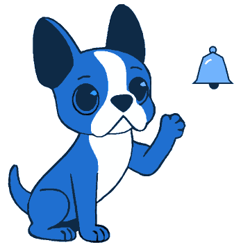

# Events

{ align=right width="180" loading=lazy }

Discord tells the bot what happens through gateway events: a message was sent, a member joined, a role changed. A listener is an async function that takes one event.

```python
--8<-- "docs/snippets/events/listeners.py"
```

`@bot.listen` reads the type hint of the first parameter and registers the function for that event class, or for each class of a union. `@bot.listen(MessageUpdate)` names the classes instead, for a function without a hint or with a broader one. The classes live in `bostie.events`, and the [event list](../reference/event-list.md) names every one with its intents and fields. A [router](routers.md) has the same decorator.

Each listener runs as its own task, so a slow listener does not hold up the others or the next event. The task starts at once: a listener's code up to its first `await` runs before the next event is handled. The listeners of `Starting` and `Stopped` are the exception: `start()` and `close()` await them one after the other. `bot.remove_listener(function)` unregisters a function from every event it listens to.

## Only what you listen to

bostie asks its Rust core to forward only the dispatch names that something in the bot uses: your listeners, the cache, command and component routing, and pending waits. Every other event is dropped before it reaches Python, so listening to nothing costs nothing. Typed events are decoded once per dispatch, and only when someone needs them.

## Intents

Discord sends most events only to a bot that asked for their intents. `Bot(intents=...)` defaults to `Intents.DEFAULT`, every intent except the three privileged ones. When a listener registers for an event none of the bot's intents delivers, bostie logs a warning naming the intent to add, and reminds you that a privileged one also has to be turned on in the Developer Portal. [Intents](gateway.md#intents) covers them in detail.

## Old values and the cache

Update events carry `old`, the object as the [cache](cache.md) had it before the change, and delete events carry the removed object: `RoleUpdate.old`, `ScheduledEventUpdate.old`, `MessageDelete.message`, `MemberRemove.member`. They are `None` when the cache did not hold the object. Messages are cached only with `Bot(max_messages=...)`, members only with `members=True`, presences only with `presences=True`.

## Waiting for an event

```python
--8<-- "docs/snippets/events/waiting.py"
```

`await bot.wait_for(Event, check=None)` returns the next event of that class for which `check` returns true. `async with bot.stream(Event, check=None) as events:` queues every matching event while the block runs, for `async for`; events that arrive while the loop body runs are not lost. Neither has a timeout of its own, so bound them with `asyncio.timeout()`. An exception raised by `check` is raised from the wait. `bot.wait_for_component` and `bot.wait_for_modal` do the same for [component uses](components.md#waiting-for-a-click-inside-a-handler) and [modal submits](modals.md#waiting-for-the-submit-inside-a-handler).

## Raw events and events bostie does not model

```python
--8<-- "docs/snippets/events/custom_events.py"
```

`@bot.listen_raw("NAME", ...)` delivers a `RawEvent` for each dispatch name you give, modelled or not, and a listener hinted with `RawEvent` gets every dispatch. A `RawEvent` has the dispatch `name`, its sequence number `seq`, and the payload as `raw` (a new `dict` each time) or `raw_json` (bytes). Every typed event has `raw` and `raw_json` too.

When Discord sends a payload that does not fit its class, for example without a field the docs call required, bostie logs a warning once per event name, and typed listeners skip that event while `RawEvent` listeners still get it.

## Events of your own

Subclass `BotEvent`, with `kw_only=True`, and send an instance with `bot.dispatch(event)`: its listeners, waits and streams get it like any other event. A subclass without a `NAME` is named after its module and class. Event classes are frozen `msgspec` structs, so their fields are declared as annotations.

## Lifecycle and shard events

bostie sends events of its own about the bot: `Starting`, `Started`, `Stopping` and `Stopped` around [the lifecycle](running.md#the-lifecycle); `ShardReady`, `ShardDisconnect`, `ShardStop` and `ShardBackpressure` about each [shard](sharding.md); `ListenerError` and `TaskError` about failures. Voice connections send [voice events](../voice/index.md#events) through the same `@bot.listen`.

## When a listener raises

An exception in a listener is sent as a `ListenerError` event with the `listener`, the `event` and the `error`. Without a `ListenerError` listener, bostie logs the exception with its traceback; with one, logging is up to you. An exception in a `ListenerError` listener is only logged.
